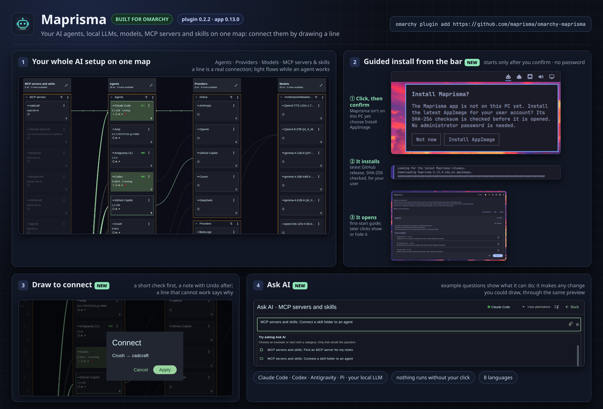

# Maprisma for Omarchy

A bar icon for **Maprisma**: your AI agents, local LLMs, models, MCP servers and skills on one map.
New to AI tools? The bar icon offers to install the app for you, and starts only after you confirm.



---

## Get started in three clicks

1. **Add the plugin:** `omarchy plugin add https://github.com/maprisma/omarchy-maprisma`
2. **Click the robot icon in the bar.** Maprisma isn't on your PC yet, so a small panel asks
   **Install Maprisma?** Choose **Install AppImage** (or **Not now**: nothing changes).
3. **Watch it install.** A terminal downloads the latest Maprisma release from GitHub with a progress bar,
   compares it with the release's SHA-256 checksum, puts it in `~/.local/bin/` for your user and opens
   Maprisma. No administrator password, no package manager, nothing running in the background.

From then on the same icon shows or hides Maprisma.

---

## What Maprisma does

- **One map of your AI setup.** Coding agents (Claude Code, Codex, Copilot, Cursor CLI, Gemini, OpenCode,
  Pi, Hermes, …), local LLMs (llama.cpp, Ollama, LM Studio, vLLM, Jan, KoboldCpp) with their models, and
  MCP servers and skills, as cards. A line means a real connection; red only marks a real problem.
- **Connect by drawing.** Draw a line from an agent to a provider, a model, an MCP server or a skill folder.
  A small dialog asks first, a note confirms it with **Undo**, and a line that cannot work says why.
  Bigger changes show a full preview; every change is written with a backup.
- **Agents working together.** When one agent hands work to another (Claude Code asking Codex, say), their
  lines take their own colour, with an arrow to the agent being used.
- **Agents at a glance.** Each agent's plan, limits and usage, what it still needs (with the command that
  fixes it), and a Security check of what it may do without asking you, each choice explained with its risk.
- **Local LLMs that fit your card.** Install llama.cpp, Ollama and others with every download checked
  against its release's SHA-256, download models, and let Maprisma measure each llama.cpp model on your
  graphics card for its best context and batch size.
- **Ask AI** from the header: example questions show what it can do. An agent or a local LLM proposes any
  change you could draw on the map, plus finding models and MCP servers; it goes through the same preview,
  and nothing runs without your click.
- **Omarchy look:** follows your Omarchy theme and window corners, 8 interface languages, `F12` window
  screenshots with a note.

---

## Install

```sh
omarchy plugin add https://github.com/maprisma/omarchy-maprisma
```

If the app is missing, the bar icon opens an **Install Maprisma?** panel. Choose
**Install AppImage** to watch the download, with a progress bar, in a terminal. The installer compares
the AppImage with the release's SHA-256 file before it puts `maprisma` in `~/.local/bin/`, then opens the
app. Later clicks show or hide its window. **Not now** leaves your PC unchanged. Ctrl+C or closing the
terminal cancels the download; once installation has finished, the app remains available from the bar icon.
No administrator password is needed.

The checksum catches a broken or incomplete download; it comes from the same GitHub release as the
AppImage, so it is not a signature.

This setup needs the Omarchy-provided `xdg-terminal-exec`, plus `curl`, `jq`, `sha256sum` and
util-linux (`flock`, `setsid`). If `fuse2` is absent, the AppImage uses its extract-and-run mode. If the
latest release or its checksum is unavailable, the terminal explains that nothing was installed and shows
the [release page](https://github.com/maprisma/maprisma/releases). Only one install runs at a time.
To remove the app later: `rm ~/.local/bin/maprisma`.

Without a terminal launcher, the bar icon says so in a notification. Install by hand instead:

```sh
v=0.14.0; f=Maprisma-$v-x86_64.AppImage
cd "$(mktemp -d)"
curl -fLO "https://github.com/maprisma/maprisma/releases/download/v$v/$f"
curl -fLO "https://github.com/maprisma/maprisma/releases/download/v$v/$f.sha256"
sha256sum -c "$f.sha256"
[ ! -e ~/.local/bin/maprisma ] && [ ! -L ~/.local/bin/maprisma ] && install -Dm755 "$f" ~/.local/bin/maprisma
```

Remove the plugin anytime with:

```sh
omarchy plugin remove ubruckhaus.maprisma
```

(Removing the plugin leaves the `maprisma` app and your settings intact.)

---

## What the plugin does

`BarWidget.qml` runs `maprisma-toggle` when the icon is clicked. The script runs `maprisma --toggle` when
the app is present. When it is missing, the bar widget opens its install panel. After consent, `install-appimage`
runs in a visible terminal, fetches only the latest release from Maprisma's GitHub repository, checks
the matching SHA-256, installs for this user and opens Maprisma in a session of its own (`setsid`), so
closing the terminal leaves it running. The installer refuses an unexpected asset name, download host,
missing or mismatched checksum, an existing target file or folder (also one that appears during the
download), a `~/.local/bin` or lock folder (or a folder above them) that other accounts may write to or that is a symlink, and a
second install while one runs. The download stays in the private lock folder, not in `$TMPDIR`. An existing `~/.local/bin` keeps its own permissions.

The plugin starts nothing when the shell starts and runs no background service. Its `installer`
capability is used only after the user's click and confirmation; it downloads the AppImage and checksum
from GitHub, writes the checked app in `~/.local/bin/`, and launches it. Maprisma's own settings belong
to the app (`~/.config/maprisma`).

## Tests

`sh tests/test-toggle.sh` tests installed and first-install flows, release and checksum failures, a second
install while one runs and a missing terminal launcher, using stand-in commands.

## License

MIT, see [LICENSE](LICENSE).
